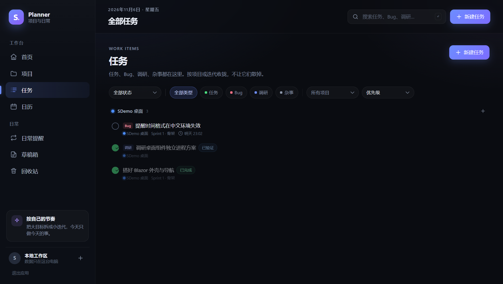
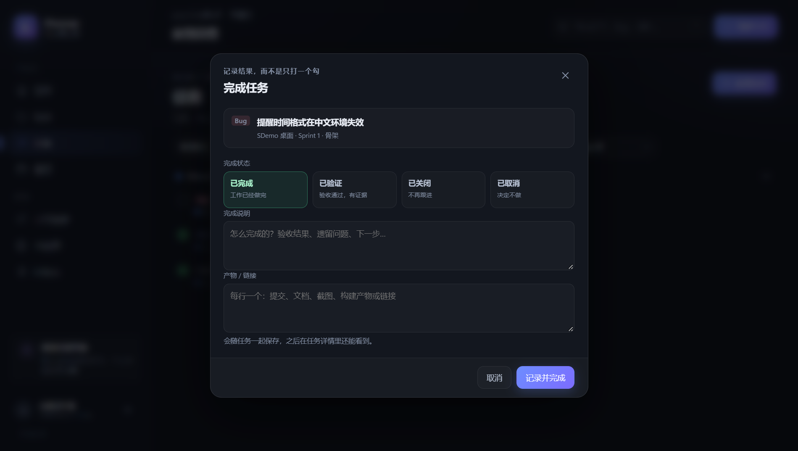
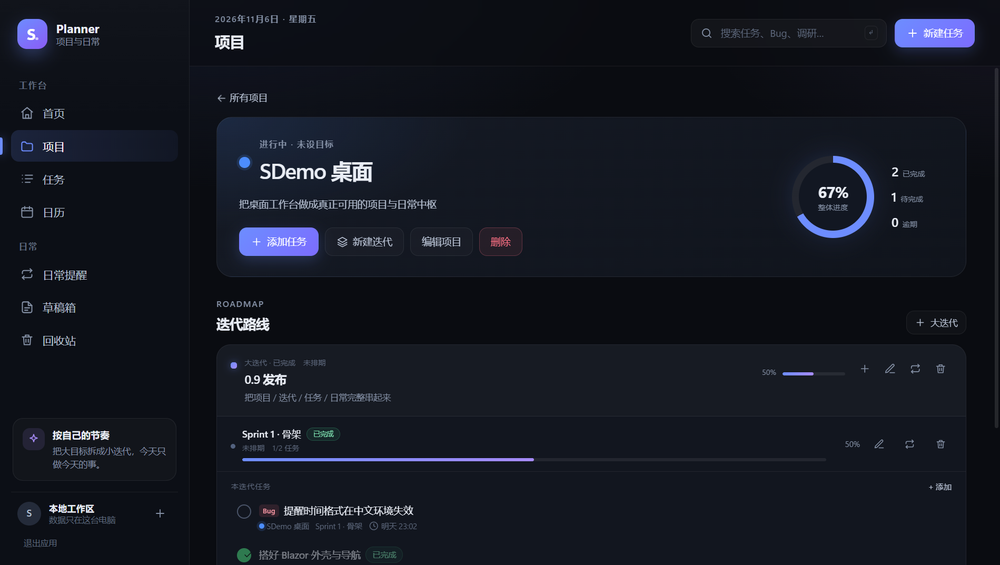

# Planner v3 · 状态、完成记录与托盘

> v2 的项目/迭代/日常模型不变。本文件只记录 v3 增量。
> 产品主文档：[planner-v2.md](planner-v2.md)；后续 v4：[planner-v4.md](planner-v4.md)；需求：[requirements.md](requirements.md)。

## 1. 工作项状态

`TodoStatus` 从 3 个状态扩展为 6 个：

| 值 | 中文 | 语义 |
| --- | --- | --- |
| `open` | 新建 | 还没开始 |
| `doing` | 进行中 | 正在推进 |
| `done` | 已完成 | 工作做完 |
| `verified` | 已验证 | 做完且有验收证据 |
| `closed` | 已关闭 | 不再跟进，但不等于完成 |
| `canceled` | 已取消 | 决定不做 |

- 终态：`done / verified / closed / canceled`。终态写 `completed_at`，非终态清空。
- 项目/迭代的「完成」统计包含 `done / verified / closed`，排除 `canceled`。
- 任务列表默认「全部状态」；终态任务排在未完成任务之后。

## 2. 完成记录

`todo` 新增两列：

- `completion_note`：完成说明，最多 4000 字。
- `artifacts_json`：产物/链接数组，JSON 文本；单条最多 500 字、最多 50 条。

完成入口：

1. 任务详情 Footer「标记完成」→ `CompleteTaskDialog`：选择终态（已完成/已验证/已关闭/已取消）、填写完成说明和产物。（v4.1 起任务行左侧不再是勾选按钮，列表右侧状态下拉可直接切终态。）
2. 任务编辑器的「状态」：切到终态时展开完成说明/产物字段，保存时调用 `SetTodoStatus`。
3. 重新打开任务：终态任务在状态下拉里切回 `open`/`doing`，完成说明/产物保留，方便复盘。

核心接口：

```csharp
TodoWriteResult SetTodoStatus(
    string id, int expectedRevision, TodoStatus status,
    string? completionNote, IReadOnlyList<string>? artifacts, WriteContext context);

TodoWriteResult PostponeTodo(string id, int expectedRevision, int days, WriteContext context);
```

## 3. 延期

- 不新增「延期」状态，延期就是移动 `due_at`。
- `PostponeTodo`：天数 clamp 1..365；已有未来截止时间从该时间顺延，否则从当前时间顺延。
- UI 入口：v4.1 起任务行右侧「延期」按钮提供 1 天/1 周/1 个月/指定时间；编辑器 Footer 仍保留「延期 1 天」。任务行仍用逾期样式表达已经超过截止时间。

## 4. 迭代完成

`iteration` 新增 `completed_at` / `completion_note`。

- `CompleteIteration(id, revision, note, context)`：大迭代完成时级联完成其所有小迭代；重复完成且说明相同是幂等的。
- `ReopenIteration(id, revision, context)`：仅 `done` 可重开，回到 `active`；子迭代不自动回滚。
- UI：项目详情的大/小迭代行右侧「完成迭代」勾按钮 / 「重开迭代」循环按钮。
- 迭代编辑器仍可直接改状态与完成说明。

## 5. 下拉框

所有原生 `<select>`（任务项目/迭代/状态、任务筛选、迭代上级/状态、项目状态）替换为 `SelectBox<TValue>`：

- 按钮 + `position: fixed` 菜单；菜单不会被 modal 的 `overflow` 裁切。
- v4.1 起移除透明 backdrop，改由 `planner.js` 监听 `document` 的 `pointerdown`/`Escape`/`scroll` 关闭，修复「点其它地方或再次点触发器收不起来」。
- `wwwroot/js/planner.js` 的 `plannerSelect.measure(trigger, count)` 计算位置；下方空间不足时向上展开。
- 同一时刻只允许一个 SelectBox 打开：`PlannerUi.SelectOpened` 事件协调。
- 保留原生 `<select>` 样式类只是历史兼容，不再用于上述位置。

## 6. 排序与搜索

- `TodoSort`：`due / priority / updated / created`，默认 `due`；任务页默认 `priority`。
- 优先级数字 1=高、2=中、3=低，排序升序；终态任务始终在未完成任务之后。
- 任务页默认状态 `all`；搜索时也会重置为 `all`。
- 关键字匹配：标题、备注、完成说明，大小写不敏感。
- 顶部搜索框回车跳转 `/tasks?q=...`，不做实时搜索。

## 7. 应用图标

- 源文件：`src/SDemo.App.Planner.Host/Assets/planner.ico`（16–256 多尺寸）。
- 展示图：`docs/images/app-icon.png`（512×512）。
- 设计：深色圆角方块 + 白色 S + 右下紫色圆点。
- 接入：csproj `ApplicationIcon` + `Resource`，WPF 主窗口 `Icon`，托盘 `ExtractIconEx`。

## 8. 托盘与后台驻留

- `TrayIcon.cs` 使用 Win32 `Shell_NotifyIcon`，**不引入 WinForms**（历史 `CS0104` 冲突）。
- 消息窗口：`HwndSource`，标题 `PlannerTrayIcon`，`ParentWindow = HWND_MESSAGE`。
- 左键/双击：恢复主窗口。
- 右键：WPF `ContextMenu`，菜单项「打开 事序 / 退出」。v4.1 起改为自绘深色圆角模板（标题区、MDL2 图标、悬停高亮），并按 DPI 把光标物理像素换算为 DIP。
- 关闭主窗口：`Hide()` 到托盘，进程与提醒 tick 继续；真正退出走菜单「退出」或侧栏「退出应用」二次确认。
- 退出时 `Shell_NotifyIcon(NIM_DELETE)` 清理图标。

## 9. 数据库迁移

`20261106144050_WorkspaceV3`：

- `todo.completion_note TEXT NULL`
- `todo.artifacts_json TEXT NULL`
- `iteration.completed_at TEXT NULL`
- `iteration.completion_note TEXT NULL`

## 10. 验证







- `dotnet build SDemo.Planner.slnf -c Release`：0 警告 0 错误。
- `dotnet test`：45/45 通过。
- 实机验证：任务完成弹窗/完成记录/产物、状态 pill、延期、迭代完成级联、下拉菜单、排序、搜索、图标、托盘隐藏/恢复/菜单。

## 11. 未做

- `project_*` / `iteration_*` / `routine_*` MCP 工具；`SetTodoStatus` / `PostponeTodo` / `CompleteIteration` 也尚未暴露为 MCP 工具。
- v2 桌面组件仍沿用 v1 `WidgetWindow`。
- 日程拖拽、重复规则未做。
- 托盘菜单未做「开机自启」开关。
